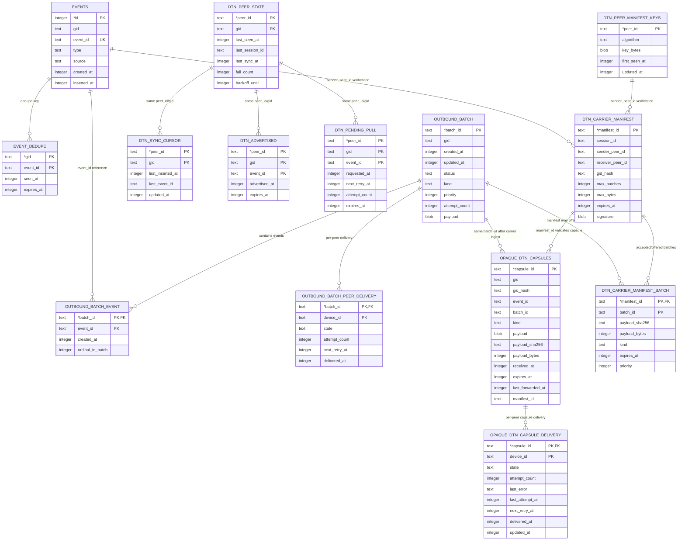

# DTN Implementation Blueprint

Status: Proposed for Engineering Implementation  
Owner: Mobile + Transport Team  
Target: Android app (`android/`) + compatible relay path (`server/`)

---

## 1. Goal

Implement a real **Store-Carry-Forward (DTN)** layer for BLE partition scenarios so that a relay user can carry messages between disconnected clusters without manual resend.

This blueprint is aligned with:
- `docs/specs/Peer_Mesh_DTN_Layer_Specification.md`
- `docs/specs/ble_dtn_transport_kpi_slo.md` (normative transport quality and acceptance contract)
- `docs/tests/DTN_Simulation_Scenarios_for_Peer_Mesh.md` (8 simulation scenarios for validation)
- Current code structure in `android/` and `server/`

---

## 2. Problem Summary (Current Gaps)

1. No peer inventory anti-entropy on BLE (no HAVE/WANT sync).
2. Forwarding mostly happens on immediate receive path, not persistent carry queue behavior.
3. Transport TTL/hop behavior is incomplete for normal traffic (TTL often not set in envelope send path).
4. No persistent per-peer sync cursor/state for BLE sync decisions.
5. No bounded storage/eviction policy for DTN store pressure.

---

## 3. Success Criteria

### 3.1 Functional

1. Node stores message locally even when no route exists.
2. On encountering a new peer, node exchanges inventory and transfers missing messages automatically.
3. Loop prevention works (`hop_count` + dedupe + TTL checks).
4. Message can traverse partition A -> relay user -> partition B without manual resend.

### 3.2 Non-functional

1. Duplicate flood controlled (target duplicate ratio < 5% in stress scenario).
2. Sync is rate-limited and batch-based.
3. Storage growth bounded by policy.
4. Chat and Map delivery, dependency repair, bounded progress, final-state
   correctness, and stability satisfy
   `docs/specs/ble_dtn_transport_kpi_slo.md`.
5. Under disrupted conditions, immediate delivery is not required; durable
   retry and 100% eventual convergence are required once a valid route becomes
   available.

Latency work must follow the stability-first decision rule in the KPI/SLO
specification. It must not advance cursors early, fabricate protocol progress,
bypass durable retry, or introduce feature-specific transport workarounds.

---

## 4. High-Level Task Breakdown

## Task A - Envelope & DTN Metadata Normalization

### A1. Add DTN metadata model

**Files**
- `android/core/src/main/java/app/peermesh/core/model/EventModels.kt`

**Change**
- Add nested DTN meta model to transport envelope.

```kotlin
@Serializable
data class DtnMeta(
    val ttl_seconds: Int,
    val hop_count: Int = 0,
    val max_hops: Int = 20,
    val priority: Int = 1,
)
```

- Extend `EventEnvelope`:

```kotlin
val dtn: DtnMeta? = null
```

### A2. Ensure envelope signature covers DTN metadata

**Files**
- `android/security/src/main/java/app/peermesh/security/crypto/EnvelopeCrypto.kt`

**Change**
- Keep signing logic over envelope-without-`sig` (already done), now including `dtn` fields.
- No special branch: just ensure serializer includes `dtn` consistently.

### A3. Enforce default transport TTL/hops on send

**Files**
- `android/data/src/main/java/app/peermesh/data/transport/EnvelopeSender.kt`
- call sites in:
  - `android/app/src/main/java/app/peermesh/GroupChatActivity.kt`
  - `android/app/src/main/java/app/peermesh/GroupMapActivity.kt`
  - `android/app/src/main/java/app/peermesh/ble/MeshAckManager.kt`
  - `android/app/src/main/java/app/peermesh/LiveTrailEventWriter.kt`

**Change**
- Do not leave transport TTL null in normal mesh sends.
- Define default send config in one place:
  - `ttl_seconds = 3600` (configurable)
  - `max_hops = 20`
  - `priority` from event type mapping.

---

## Task B - DTN Inventory Sync Protocol (BLE)

### B1. Add control packet protocol for anti-entropy

**New files**
- `android/transport/src/main/java/app/peermesh/transport/ble/dtn/DtnControlModels.kt`
- `android/transport/src/main/java/app/peermesh/transport/ble/dtn/DtnControlCodec.kt`

**Packet types**
1. `hello`
2. `inv_have`
3. `inv_want`
4. `data`
5. `ack`

**Minimal JSON schema**

```json
{
  "v": 1,
  "type": "inv_have",
  "peer_id": "...",
  "gid": "...",
  "session_id": "...",
  "mode": "id_list",
  "ids": ["event_id_1", "event_id_2"],
  "ts": 1736500000
}
```

### B2. Add DTN sync engine

**New files**
- `android/transport/src/main/java/app/peermesh/transport/ble/dtn/DtnSyncEngine.kt`
- `android/transport/src/main/java/app/peermesh/transport/ble/dtn/DtnInventoryBuilder.kt`
- `android/transport/src/main/java/app/peermesh/transport/ble/dtn/DtnDiffResolver.kt`
- `android/transport/src/main/java/app/peermesh/transport/ble/dtn/DtnForwardPolicy.kt`

**Responsibilities**
- Session lifecycle per peer/gid.
- Build local inventory window.
- Compute missing IDs.
- Request and send missing messages in batches.
- Track per-peer sync cursor and backoff.

### B3. Integrate engine into BLE transport

**Files**
- `android/transport/src/main/java/app/peermesh/transport/ble/BleMeshTransport.kt`

**Change**
- Route incoming reassembled payload:
  - If control packet -> `DtnSyncEngine.onControlPacket(...)`
  - Else envelope -> normal ingest path + enqueue candidate for DTN advertise.
- Trigger `hello/inv_have` when peer is newly matched or recently stale.

---

## Task C - Room Schema for DTN State

### C1. Add new entities

**New files**
- `android/data/src/main/java/app/peermesh/data/db/entity/DtnPeerStateEntity.kt`
- `android/data/src/main/java/app/peermesh/data/db/entity/DtnAdvertisedEntity.kt`
- `android/data/src/main/java/app/peermesh/data/db/entity/DtnSyncCursorEntity.kt`
- `android/data/src/main/java/app/peermesh/data/db/entity/DtnPendingPullEntity.kt`

### C2. Add DAOs

**New files**
- `android/data/src/main/java/app/peermesh/data/db/dao/DtnPeerStateDao.kt`
- `android/data/src/main/java/app/peermesh/data/db/dao/DtnAdvertisedDao.kt`
- `android/data/src/main/java/app/peermesh/data/db/dao/DtnSyncCursorDao.kt`
- `android/data/src/main/java/app/peermesh/data/db/dao/DtnPendingPullDao.kt`

### C3. Wire AppDatabase

**Files**
- `android/data/src/main/java/app/peermesh/data/db/AppDatabase.kt`
- `android/data/src/main/java/app/peermesh/data/db/DatabaseMigrations.kt`

**Change**
1. Add entities + DAO getters.
2. Bump DB version.
3. Add migration SQL:
   - create 4 DTN tables
   - add indexes for `(peer_id,gid,last_seen_at)` and `(gid,event_id)` style lookups.

---

## Task D - Event Store Query Support

### D1. Add query APIs for inventory window

**Files**
- `android/data/src/main/java/app/peermesh/data/db/dao/EventsDao.kt`

**Add**
1. List recent event IDs per gid ordered by `(inserted_at,event_id)`.
2. Fetch envelopes by `(gid,event_id)` set for `DATA` response.
3. Cursor-based pull for peer sync per gid.

### D2. Add storage cap + eviction policy

**Files**
- `android/data/src/main/java/app/peermesh/data/db/dao/EventsDao.kt`
- `android/data/src/main/java/app/peermesh/data/cleanup` (new package)

**New files**
- `android/data/src/main/java/app/peermesh/data/cleanup/DtnStorageEvictor.kt`

**Policy**
1. Expired first.
2. Low priority next.
3. Oldest last.

This bounds the forwarding/cache store. It must not silently remove the last
durable repair source for an accepted delivery-eligible Chat or Map event;
retention and eventual-delivery requirements are defined by
`docs/specs/ble_dtn_transport_kpi_slo.md`.

**Config defaults**
- max event store budget: 50 MB (configurable).

---

## Task E - Forwarding Rules Hardening

### E1. Replace TTL-only forward assumptions

**Files**
- `android/transport/src/main/java/app/peermesh/transport/ble/TtlForwarder.kt`
- `android/transport/src/main/java/app/peermesh/transport/ble/BleMeshTransport.kt`

**Rules**
1. Drop if `now > ts + dtn.ttl_seconds`.
2. Drop if `dtn.hop_count >= dtn.max_hops`.
3. On forward: `hop_count = hop_count + 1`.
4. Keep existing dedupe (`gid,event_id`) before forward.

### E2. Priority scheduler

**Files**
- `android/transport/src/main/java/app/peermesh/transport/ble/dtn/DtnForwardPolicy.kt`

**Priority map**
- `0`: critical alert
- `1`: safety info
- `2`: map marker
- `3`: chat

Use in batch ordering for sync transfer.

---

## Task F - Observability & Diagnostics

### F1. Add DTN metrics/log markers

**Files**
- `android/app/src/main/java/app/peermesh/ble/BleMeshDiagnosticsLogger.kt`
- `android/data/src/main/java/app/peermesh/data/debug/ActivityLog` usage points

**Log labels**
1. `DTN hello sent/recv`
2. `DTN inv_have sent/recv`
3. `DTN inv_want sent/recv`
4. `DTN data sent/recv`
5. `DTN sync summary`
6. `DTN drop reason=ttl|hops|dedupe|invalid`

---

## Task G - Opaque DTN Carrier Store for Non-Member Relay

### G1. Why this task exists

Physical testing showed that a node which has left a group cannot bridge A -> B with the current member-only DTN path.

Current limitation:
1. DTN inventory is built from decrypted `events`.
2. DTN scope is driven by `ActiveGroupManager.getActiveGroup(...)`.
3. Leaving a group removes member/UI state and can remove event inventory.
4. Therefore a non-member carrier has no inventory to advertise, even if it still sees peers.

Required model:
- A carrier can store, dedupe, advertise, and forward encrypted capsules without being a visible member and without rendering group data.
- Decrypt/ingest remains a member-only path.

### G2. Add opaque capsule schema

**New files**
- `android/data/src/main/java/app/peermesh/data/db/entity/OpaqueDtnCapsuleEntity.kt`
- `android/data/src/main/java/app/peermesh/data/db/dao/OpaqueDtnCapsuleDao.kt`

**Suggested columns**
- `capsule_id TEXT PRIMARY KEY`
- `gid TEXT NOT NULL`
- `event_id TEXT`
- `batch_id TEXT`
- `kind TEXT NOT NULL` (`envelope`, `app_batch`)
- `payload BLOB NOT NULL`
- `created_t INTEGER NOT NULL`
- `received_at INTEGER NOT NULL`
- `expires_at INTEGER`
- `hop_count INTEGER NOT NULL DEFAULT 0`
- `max_hops INTEGER NOT NULL`
- `priority INTEGER NOT NULL`
- `source_peer_id TEXT`
- `last_forwarded_at INTEGER`
- `manifest_id TEXT`

**Indexes**
- `(gid, received_at)`
- `(gid, event_id)`
- `(expires_at)`
- `(priority, received_at)`

### G2b. Add signed carrier session manifest

To avoid repeating a full app-batch signature on every DATA payload while still blocking fake batch spam, use a signed manifest at the start of each carrier session.

**New files**
- `android/data/src/main/java/app/peermesh/data/db/entity/DtnCarrierManifestEntity.kt`
- `android/data/src/main/java/app/peermesh/data/db/entity/DtnCarrierManifestBatchEntity.kt`
- `android/data/src/main/java/app/peermesh/data/db/dao/DtnCarrierManifestDao.kt`

**Control packets**
1. `manifest_offer`
2. `manifest_accept`

**Manifest fields**
- `manifest_id`
- `session_id`
- `sender_peer_id`
- `receiver_peer_id` or peer scope
- `gid_hash`
- `max_batches`
- `max_bytes`
- `expires_at`
- `nonce`
- batch entries:
  - `batch_id`
  - `payload_sha256`
  - `payload_bytes`
  - `kind`
  - `expires_at`
  - `priority`
- `signature`

**Rules**
1. Sender sends `manifest_offer` before DATA.
2. Receiver verifies manifest signature, session expiry, quota, peer limits, and batch count/bytes.
3. Receiver replies with `manifest_accept` listing accepted batch IDs.
4. Sender sends DATA in the existing compact batch payload shape.
5. Receiver accepts DATA only if `(session_id, batch_id)` is present in an accepted manifest and the received payload hash/size match the signed manifest entry.
6. Batch ID alone is not sufficient for acceptance.
7. Manifest state must be persisted so a carrier node can store now and forward later.

This makes the session quota explicit and amortizes signature overhead across many DATA batches.

### G3. Add carrier ingest path

**Files**
- `android/data/src/main/java/app/peermesh/data/ingest/EnvelopeReceiverImpl.kt`
- `android/transport/src/main/java/app/peermesh/transport/ble/BleMeshTransport.kt`

**Rules**
1. If payload can be member-decrypted, use normal verified ingest.
2. If payload cannot be decrypted but is structurally carrier-safe, store as opaque capsule.
3. Carrier-safe means:
   - valid outer envelope or app-batch structure,
   - bounded payload size,
   - TTL not expired,
   - hop count below max,
   - dedupe key not seen,
   - for compact DATA, hash/size match an accepted signed manifest entry.
4. Do not render opaque payload in UI.
5. Do not write opaque payload into `events`.

**Receive/decode/forward flow**
1. Receiver gets `manifest_offer` before compact DATA.
2. Receiver verifies manifest signature, peer/session quota, expiry, and per-batch hash/size metadata.
3. Receiver persists accepted manifest state and replies with `manifest_accept`.
4. Receiver gets compact DATA with `session_id` and `batch_id`.
5. Receiver accepts the payload into carrier store only if `(session_id, batch_id)` was accepted and payload hash/size match the signed manifest entry.
6. If receiver has group key, it may then attempt member decrypt/validate/ingest:
   - on success, write normal event state and render only if the user is still a member;
   - on failure, keep only the opaque carrier copy if carrier policy allows it.
7. If receiver has no group key, it must not render or ingest into `events`; it only stores the opaque capsule.
8. Forwarding to the next peer is demand-driven: advertise inventory, wait for `want`, then send manifest/compact DATA.
9. A carrier may forward the original valid manifest or create a new carrier manifest signed by itself, but the forwarded data payload must remain hash-bound to the manifest accepted by the next receiver.
10. The final member receiver still decrypts and validates the inner event/app batch; manifest validation is an anti-spam/admission gate, not content authorization.

### G4. Extend DTN inventory/data APIs

**Files**
- `android/data/src/main/java/app/peermesh/data/dtn/RoomDtnInventoryStore.kt`
- `android/transport/src/main/java/app/peermesh/transport/ble/dtn/DtnInventoryStore.kt`
- `android/transport/src/main/java/app/peermesh/transport/ble/dtn/DtnSyncEngine.kt`

**Change**
- Inventory must merge:
  1. member events from `events`,
  2. opaque capsules from `opaque_dtn_capsules`.
- `DATA` response must return either rebuilt member envelope or stored opaque payload.
- ACK should remove/mark peer delivery for both sources.
- When serving compact opaque DATA, include or reference the persisted manifest so the next receiver can validate hash-bound batch IDs before accepting payload bytes.

### G5. Replace single active-gid scope with sync scope set

**Files**
- `android/app/src/main/java/app/peermesh/ble/BleMeshRuntime.kt`
- `android/transport/src/main/java/app/peermesh/transport/ble/BleMeshTransport.kt`
- Nordic backend equivalent.

**Change**
- Replace `dtnActiveGidProvider: () -> String?` with a provider that returns a set/list of sync scopes.
- Include:
  1. active member gid(s),
  2. carrier gid(s) with non-expired opaque capsules.

### G6. Leave-group behavior with carrier mode

When user leaves a group:
1. Remove visible membership/profile state.
2. Clear active group.
3. Keep or remove decrypt key according to product policy.
4. If carrier mode is enabled, keep encrypted capsules only in `opaque_dtn_capsules`.
5. Do not keep chat/map/live trail UI state for non-member use.

### G7. Acceptance criteria

1. C can leave the A/B group and disappear from group UI.
2. A sends while B is offline.
3. C encounters A and stores opaque capsules without rendering messages.
4. C later encounters B and transfers capsules through DTN `hello -> inv_have -> inv_want -> data -> ack`.
5. B decrypts and renders the messages.
6. C cannot read/render the group after key removal when cryptographic leave is enabled.
7. Storage caps and TTL cleanup remove expired opaque capsules.
8. Fake payload with a known batch ID but mismatched hash is rejected.
9. A peer exceeding manifest quota is throttled or blocked before payload transfer.

---

## 4.1 DTN Database Relationships and Tables (Current Android Schema)

This section documents the Room tables currently involved in the Android DTN module and adjacent sender/dedupe queues. It is based on `DatabaseMigrations.kt` migrations `27 -> 34` and the matching Room entity classes.

### 4.1.1 Relationship Diagram



Relationship notes:
- `events` is the member-readable event store. Non-member carriers must not write opaque payloads into this table.
- `event_dedupe` prevents repeat ingest/relay of already seen `(gid,event_id)` pairs.
- `outbound_batch*` is the persistent local app-batch send queue used before a payload becomes delivered or carrier-offered.
- `dtn_peer_state`, `dtn_sync_cursor`, `dtn_advertised`, and `dtn_pending_pull` are the member-event anti-entropy state tables.
- `dtn_carrier_manifest*`, `dtn_peer_manifest_keys`, and `opaque_dtn_capsules` are the Full DTN carrier tables for signed manifest admission and encrypted store-carry-forward.
- Some relationships are logical rather than enforced by foreign keys because carrier rows must survive without member-visible event rows.
- `opaque_dtn_capsule_delivery` tracks per-target opaque capsule delivery state by `(capsule_id, device_id)`, replacing the old global `last_forwarded_at`-only retry behavior.

### 4.1.2 `dtn_peer_state`

Purpose: one row per remote peer and gid scope, used to remember encounter health, last session, sync success, and backoff.

Primary key: `(peer_id, gid)`

| Column | Type | Meaning |
|---|---|---|
| `peer_id` | `TEXT NOT NULL` | Stable DTN peer/device id observed over BLE. |
| `gid` | `TEXT NOT NULL` | Group/sync scope for this peer state. |
| `last_seen_at` | `INTEGER NOT NULL` | Unix seconds when this peer was last seen in this gid scope. |
| `last_session_id` | `TEXT` | Most recent DTN session id associated with the peer/gid. |
| `last_sync_at` | `INTEGER` | Unix seconds of the last successful or no-missing sync. |
| `fail_count` | `INTEGER NOT NULL` | Consecutive sync/control failures used for backoff. |
| `backoff_until` | `INTEGER` | Unix seconds before which sync should be suppressed for this peer/gid. |

Indexes:
- `(peer_id, gid, last_seen_at)`
- `(gid, last_seen_at)`

### 4.1.3 `dtn_sync_cursor`

Purpose: per peer/gid cursor for inventory windows so `inv_have` can resume without always advertising the same oldest items.

Primary key: `(peer_id, gid)`

| Column | Type | Meaning |
|---|---|---|
| `peer_id` | `TEXT NOT NULL` | Remote peer/device id the cursor belongs to. |
| `gid` | `TEXT NOT NULL` | Group/sync scope for this cursor. |
| `last_inserted_at` | `INTEGER NOT NULL` | Last local `events.inserted_at` position advertised to this peer. |
| `last_event_id` | `TEXT NOT NULL` | Tie-breaker event id for deterministic cursor continuation. |
| `updated_at` | `INTEGER NOT NULL` | Unix seconds when the cursor was last advanced. |

Indexes:
- `(gid, updated_at)`

### 4.1.4 `dtn_advertised`

Purpose: remembers event ids already advertised to a peer so anti-entropy can suppress repeated HAVE noise within a TTL.

Primary key: `(peer_id, gid, event_id)`

| Column | Type | Meaning |
|---|---|---|
| `peer_id` | `TEXT NOT NULL` | Remote peer that received the advertisement. |
| `gid` | `TEXT NOT NULL` | Group/sync scope. |
| `event_id` | `TEXT NOT NULL` | Event id advertised in an `inv_have` window. |
| `advertised_at` | `INTEGER NOT NULL` | Unix seconds when the id was advertised. |
| `expires_at` | `INTEGER` | Optional expiry for pruning advertisement memory. |

Indexes:
- `(gid, event_id)`
- `(peer_id, gid, advertised_at)`
- `(expires_at)`

### 4.1.5 `dtn_pending_pull`

Purpose: tracks event ids requested from a peer but not yet satisfied, including retry timing and expiry.

Primary key: `(peer_id, gid, event_id)`

| Column | Type | Meaning |
|---|---|---|
| `peer_id` | `TEXT NOT NULL` | Peer expected to provide the event. |
| `gid` | `TEXT NOT NULL` | Group/sync scope. |
| `event_id` | `TEXT NOT NULL` | Event id requested via `inv_want`. |
| `requested_at` | `INTEGER NOT NULL` | Unix seconds when the pull was first/last requested. |
| `next_retry_at` | `INTEGER` | Unix seconds when another request can be attempted. |
| `attempt_count` | `INTEGER NOT NULL` | Number of pull attempts. |
| `expires_at` | `INTEGER` | Optional expiry after which the pending pull is dropped. |

Indexes:
- `(gid, event_id)`
- `(peer_id, gid, next_retry_at)`
- `(expires_at)`

### 4.1.6 `opaque_dtn_capsules`

Purpose: carrier store for encrypted envelopes/app batches that a non-member relay can keep and forward without decrypting or rendering.

Primary key: `capsule_id`

| Column | Type | Meaning |
|---|---|---|
| `capsule_id` | `TEXT NOT NULL` | Stable opaque capsule id, typically derived from payload hash/transport metadata. |
| `gid` | `TEXT NOT NULL` | Clear routing scope when available; used for carrier sync scope discovery. |
| `gid_hash` | `TEXT` | Hash of gid for manifest/privacy-aware matching. |
| `event_id` | `TEXT` | Inner event id when the payload shape exposes one; null for app-batch-only capsules. |
| `batch_id` | `TEXT` | App batch id for batch payloads; used for retry/delete by batch. |
| `kind` | `TEXT NOT NULL` | Capsule type, currently `envelope` or `app_batch`. |
| `payload` | `BLOB NOT NULL` | Original encrypted/opaque payload bytes to forward. |
| `payload_sha256` | `TEXT NOT NULL` | SHA-256 hash used for integrity, dedupe, and manifest binding. |
| `payload_bytes` | `INTEGER NOT NULL` | Payload size in bytes, also checked against manifest quota/entry. |
| `created_t` | `INTEGER NOT NULL` | Payload creation time if known; may be `0` for legacy/opaque app batches. |
| `received_at` | `INTEGER NOT NULL` | Unix seconds when this carrier stored the capsule. |
| `expires_at` | `INTEGER` | Expiry for pruning. Existing legacy rows may be null and must be handled by hygiene cleanup. |
| `hop_count` | `INTEGER NOT NULL` | Carrier hop count already applied to this capsule. |
| `max_hops` | `INTEGER NOT NULL` | Maximum allowed carrier hops. |
| `priority` | `INTEGER NOT NULL` | Forwarding priority, lower number means more important. |
| `source_peer_id` | `TEXT` | Peer/device id believed to be the source/origin; used to avoid forwarding back to origin. |
| `last_forwarded_at` | `INTEGER` | Unix seconds when this capsule was last successfully forwarded or marked forwarded. |
| `manifest_id` | `TEXT` | Manifest that authorized the carrier DATA, when applicable. |

Indexes:
- `(gid, received_at)`
- `(gid, event_id)`
- `(batch_id)`
- `(expires_at)`
- `(priority, received_at)`
- `(manifest_id)`

### Identity Naming and Wire-Field Conventions

Canonical identity model:

- `peer_id` and `device_id` refer to the same canonical node identity.
- `device_id` is the preferred term for new transport and routing logic.
- Older DTN tables or compatibility code may still use the legacy label `peer_id`.

Abbreviated wire fields:

| Field | Meaning |
|---|---|
| `did` | Canonical device id of the DTN control packet sender. |
| `sid` | Source/origin device id that first created an app batch. |
| `rid` | Relay/direct-sender device id that sent the current app batch hop. |

Rules:

1. DTN control packets should emit `did` on the wire.
2. Decoders must accept both `did` and legacy `peer_id` during migration.
3. New app batches must stamp:
   - `sid = local device_id`
   - `rid = local device_id`
4. Repacked/relayed app batches must:
   - preserve `sid`
   - overwrite `rid` with the relay's current local device id
5. Receivers should use:
   - `sid` to avoid forwarding back to origin
   - `rid` to avoid forwarding back to the direct previous hop
   - `rid` to refresh BLE `address -> canonical device_id` mapping

Rationale:

- Origin identity and direct-sender identity are different signals.
- Conflating them causes relay loops, stale next-hop suppression, and poor address remapping under BLE address churn.

### 4.1.6b `opaque_dtn_capsule_delivery`

Purpose: per-target delivery scheduler state for opaque carrier capsules. This prevents one global `last_forwarded_at` from incorrectly suppressing or retrying a capsule for every peer.

Primary key: `(capsule_id, device_id)`

Foreign key:
- `capsule_id -> opaque_dtn_capsules.capsule_id ON DELETE CASCADE`

| Column | Type | Meaning |
|---|---|---|
| `capsule_id` | `TEXT NOT NULL` | Parent opaque capsule id. |
| `device_id` | `TEXT NOT NULL` | Target peer/device id. |
| `state` | `TEXT NOT NULL` | Per-peer delivery state, such as queued, delivered, or failed-retryable. |
| `attempt_count` | `INTEGER NOT NULL` | Number of send attempts for this capsule/target pair. |
| `last_error` | `TEXT` | Last failure reason for this target. |
| `last_attempt_at` | `INTEGER` | Unix seconds of the last send attempt. |
| `next_retry_at` | `INTEGER` | Unix seconds when retry becomes eligible. |
| `delivered_at` | `INTEGER` | Unix seconds when send completed successfully for this target. |
| `updated_at` | `INTEGER NOT NULL` | Unix seconds when this row last changed. |

Indexes:
- `(device_id, state)`
- `(state, next_retry_at)`
- `(capsule_id, state)`

Scheduling policy:
1. New capsules never sent to a target are preferred first.
2. Hot failed/incomplete retries are next.
3. Older never-sent capsules follow.
4. Normal failed retries follow.
5. Already-forwarded or legacy-forwarded capsules have the lowest priority.

Migration caveat:
- Legacy capsules created before this table may have `last_forwarded_at != NULL` but no delivery rows.
- Such capsules must not be interpreted as never-sent. They should be suppressed or backfilled during migration/hygiene cleanup.

### 4.1.7 `dtn_carrier_manifest`

Purpose: signed carrier-session admission record. A receiver accepts compact carrier DATA only when it matches an accepted manifest.

Primary key: `manifest_id`

| Column | Type | Meaning |
|---|---|---|
| `manifest_id` | `TEXT NOT NULL` | Unique manifest/session offer id. |
| `session_id` | `TEXT NOT NULL` | DTN encounter/session id this manifest belongs to. |
| `sender_peer_id` | `TEXT NOT NULL` | Peer that signed/offered the manifest. |
| `receiver_peer_id` | `TEXT` | Intended receiver peer, if the offer is scoped to one receiver. |
| `gid_hash` | `TEXT NOT NULL` | Hash of gid/scope for privacy-aware admission and lookup. |
| `max_batches` | `INTEGER NOT NULL` | Hard quota for accepted batch count in this manifest. |
| `max_bytes` | `INTEGER NOT NULL` | Hard quota for accepted payload bytes in this manifest. |
| `expires_at` | `INTEGER NOT NULL` | Unix seconds when the manifest is no longer valid. |
| `nonce` | `TEXT NOT NULL` | Anti-replay random value included in the signed payload. |
| `signature` | `BLOB NOT NULL` | ECDSA signature over canonical manifest fields. |
| `created_at` | `INTEGER NOT NULL` | Unix seconds when the manifest was created/stored. |
| `accepted_at` | `INTEGER` | Unix seconds when local policy accepted the manifest; null if only stored/offered. |

Indexes:
- `(session_id)`
- `(sender_peer_id, expires_at)`
- `(gid_hash, expires_at)`
- `(expires_at)`

### 4.1.8 `dtn_carrier_manifest_batch`

Purpose: per-batch hash/size/expiry entries bound to a carrier manifest. This table is the anti-spam gate for carrier DATA.

Primary key: `(manifest_id, batch_id)`

Foreign key:
- `manifest_id -> dtn_carrier_manifest.manifest_id ON DELETE CASCADE`

| Column | Type | Meaning |
|---|---|---|
| `manifest_id` | `TEXT NOT NULL` | Parent manifest id. |
| `batch_id` | `TEXT NOT NULL` | App batch id being offered/accepted. |
| `payload_sha256` | `TEXT NOT NULL` | Expected SHA-256 hash of the carrier DATA payload. |
| `payload_bytes` | `INTEGER NOT NULL` | Expected payload byte size. |
| `kind` | `TEXT NOT NULL` | Payload kind, for example `app_batch`. |
| `expires_at` | `INTEGER NOT NULL` | Per-batch expiry copied from/compatible with manifest TTL policy. |
| `priority` | `INTEGER NOT NULL` | Batch forwarding priority for scheduling. |

Indexes:
- `(batch_id)`
- `(payload_sha256)`
- `(expires_at)`
- `(priority, expires_at)`

### 4.1.9 `dtn_peer_manifest_keys`

Purpose: local registry of peer public keys used to verify signed carrier manifests.

Primary key: `peer_id`

| Column | Type | Meaning |
|---|---|---|
| `peer_id` | `TEXT NOT NULL` | Peer id that owns this manifest verification key. |
| `algorithm` | `TEXT NOT NULL` | Key/signature algorithm, currently ECDSA P-256/SHA-256 in runtime. |
| `key_bytes` | `BLOB NOT NULL` | Encoded public key bytes learned through DTN `manifest_key`. |
| `first_seen_at` | `INTEGER NOT NULL` | Unix seconds when this key was first learned. |
| `updated_at` | `INTEGER NOT NULL` | Unix seconds when this key was last refreshed. |

Indexes:
- `(algorithm, updated_at)`

### 4.1.10 `outbound_batch`

Purpose: persistent local app-batch send queue used by BLE mesh and carrier manifest offer generation.

Primary key: `batch_id`

| Column | Type | Meaning |
|---|---|---|
| `batch_id` | `TEXT NOT NULL` | App batch id. |
| `gid` | `TEXT NOT NULL` | Group/scope for contained events. |
| `created_at` | `INTEGER NOT NULL` | Unix seconds when the batch was created. |
| `updated_at` | `INTEGER NOT NULL` | Unix seconds when queue state last changed. |
| `status` | `TEXT NOT NULL` | Queue status such as pending/sent/failed-retryable, as used by `OutboundBatchDispatcher`. |
| `lane` | `TEXT NOT NULL` | Freshness lane, for example `FRESH` or `BACKLOG`, to avoid old backlog starving new sends. |
| `priority` | `INTEGER NOT NULL` | Scheduling priority; lower value is more important. |
| `attempt_count` | `INTEGER NOT NULL` | Number of transport attempts for this batch. |
| `last_error` | `TEXT` | Most recent transport failure reason. |
| `locked_at` | `INTEGER` | Claim/lock timestamp while a dispatcher is working on it. |
| `sent_at` | `INTEGER` | Timestamp when the batch was marked sent. |
| `payload` | `BLOB NOT NULL` | Serialized app-batch payload bytes. |
| `event_count` | `INTEGER NOT NULL` | Number of events in the batch. |
| `first_event_created_t` | `INTEGER NOT NULL` | Oldest contained event creation timestamp. |
| `last_event_created_t` | `INTEGER NOT NULL` | Newest contained event creation timestamp. |
| `source` | `TEXT NOT NULL` | Source lane/origin, e.g. local mesh or relay seed. |

Indexes:
- `(status, lane, created_at)`
- `(gid, status, lane, created_at)`
- `(locked_at)`

### 4.1.11 `outbound_batch_event`

Purpose: maps app batches back to their event ids for diagnostics, delivery completion, and batch rebuild metadata.

Primary key: `(batch_id, event_id)`

Foreign key:
- `batch_id -> outbound_batch.batch_id ON DELETE CASCADE`

| Column | Type | Meaning |
|---|---|---|
| `batch_id` | `TEXT NOT NULL` | Parent outbound batch id. |
| `event_id` | `TEXT NOT NULL` | Event id included in the batch. |
| `created_t` | `INTEGER NOT NULL` | Event creation timestamp. |
| `ordinal_in_batch` | `INTEGER NOT NULL` | Stable order of the event inside the serialized batch. |

Indexes:
- `(batch_id, ordinal_in_batch)`
- `(event_id)`

### 4.1.12 `outbound_batch_peer_delivery`

Purpose: per-target delivery state for an outbound batch, allowing retry only to peers still missing the payload.

Primary key: `(batch_id, device_id)`

Foreign key:
- `batch_id -> outbound_batch.batch_id ON DELETE CASCADE`

| Column | Type | Meaning |
|---|---|---|
| `batch_id` | `TEXT NOT NULL` | Parent outbound batch id. |
| `device_id` | `TEXT NOT NULL` | Target peer/device id. |
| `state` | `TEXT NOT NULL` | Delivery state for this peer, such as queued, delivered, or retryable failure. |
| `attempt_count` | `INTEGER NOT NULL` | Number of attempts for this peer. |
| `last_error` | `TEXT` | Last failure reason for this peer. |
| `last_attempt_at` | `INTEGER` | Unix seconds of the last send attempt. |
| `next_retry_at` | `INTEGER` | Unix seconds when retry becomes eligible. |
| `delivered_at` | `INTEGER` | Unix seconds when delivery completed. |
| `updated_at` | `INTEGER NOT NULL` | Unix seconds when this row last changed. |

Indexes:
- `(batch_id, state)`
- `(device_id, state)`
- `(state, next_retry_at)`

### 4.1.13 `event_dedupe`

Purpose: persistent dedupe for event ingest/forward decisions.

Primary key: `(gid, event_id)`

| Column | Type | Meaning |
|---|---|---|
| `gid` | `TEXT NOT NULL` | Group/scope. |
| `event_id` | `TEXT NOT NULL` | Event id that has already been seen. |
| `seen_at` | `INTEGER NOT NULL` | Unix seconds when the event was first marked seen. |
| `expires_at` | `INTEGER NOT NULL` | Unix seconds when dedupe memory can be pruned. |

Indexes:
- `(expires_at)`

### 4.1.14 `events` (DTN-adjacent member store)

Purpose: canonical member-readable event store. DTN member inventory reads from this table; opaque carriers should not write unreadable payloads here.

Important columns:

| Column | Type | Meaning |
|---|---|---|
| `id` | `INTEGER PRIMARY KEY AUTOINCREMENT` | Local row id. |
| `gid` | `TEXT NOT NULL` | Group/scope. |
| `event_id` | `TEXT NOT NULL` | Signed event id, unique with gid. |
| `type` | `TEXT NOT NULL` | Event type such as `CHAT.MSG`, `MAP.*`, or `SYS.*`. |
| `source` | `TEXT NOT NULL` | Local ingest source, e.g. local, mesh, dtn. |
| `created_t` | `INTEGER NOT NULL` | Event creation timestamp from the envelope. |
| `time_lt` | `INTEGER NOT NULL` | Logical time used by reducers/order. |
| `actor_did` | `TEXT NOT NULL` | Actor DID from the event envelope. |
| `ttl_s` | `INTEGER` | Optional content/business TTL. |
| `payload_json` | `TEXT NOT NULL` | Event payload JSON after successful decrypt/verify. |
| `inserted_at` | `INTEGER NOT NULL` | Local insertion timestamp used by DTN inventory cursors. |
| `invalid_at` | `INTEGER` | Timestamp when reducer marked the event invalid. |
| `invalid_reason` | `TEXT` | Reason for invalidation. |

Indexes:
- unique `(gid, event_id)`
- `(gid, created_t)`
- `(gid, type)`

---

## 5. Suggested API/Model Snippets

### 5.1 Control packet base

```kotlin
@Serializable
data class DtnControlPacket(
    val v: Int = 1,
    val type: String,
    val peer_id: String,
    val gid: String? = null,
    val session_id: String? = null,
    val ts: Long,
)
```

### 5.2 Peer state table shape

```sql
CREATE TABLE dtn_peer_state (
  peer_id TEXT NOT NULL,
  gid TEXT NOT NULL,
  last_seen_at INTEGER NOT NULL,
  last_session_id TEXT,
  last_sync_at INTEGER,
  fail_count INTEGER NOT NULL DEFAULT 0,
  backoff_until INTEGER,
  PRIMARY KEY (peer_id, gid)
);
```

---

## 6. Server Compatibility Notes

1. Scenario 1 (BLE-only partition bridge) does not require server API changes.
2. If relay ingest/fetch receives envelope with `dtn`, keep parser tolerant.
3. Optional: expose DTN fields in debug/admin endpoints only (no behavior dependency).

---

## 7. Rollout Plan

## Phase 1 (Must-have)

1. Task A complete.
2. Task C minimal schema (`dtn_peer_state`, `dtn_sync_cursor`).
3. Task B ID-list mode only (no Bloom).
4. Task E loop/ttl/hops enforcement.
5. Task G minimal opaque carrier path for non-member relay in partition bridge tests.

## Phase 2 (Stability)

1. Add `dtn_advertised` + `dtn_pending_pull`.
2. Add batching + rate limits + retry/backoff.
3. Add storage cap/eviction.
4. Harden opaque carrier cleanup, quota, and per-peer anti-spam limits.

## Phase 3 (Optimization)

1. Bloom filter mode.
2. Adaptive inventory window by bandwidth/peer quality.
3. Rich DTN metrics dashboard/test tooling.

---

## 8. Test Plan (Copy-ready)

Scenario source of truth for end-to-end validation:
- `docs/tests/DTN_Simulation_Scenarios_for_Peer_Mesh.md`

## Scenario S1 - Urban Blackout Partition Bridge

Given:
1. Two BLE partitions A and B disconnected.
2. Node X receives event in A.
3. X moves to B.

Expect:
1. Event persists on X while disconnected.
2. On first encounter in B, inventory sync runs automatically.
3. Missing event transferred to B without manual resend.
4. No infinite loop; duplicate ratio under threshold.
5. Event TTL valid at delivery time.

## Scenario S2 - Duplicate Stress

1. 1000 backlog events.
2. Repeated peer encounters.
3. Verify dedupe tables prevent repeated full resend.

## Scenario S3 - Expiry/Hops

1. Event near expiry -> dropped by TTL rule.
2. Event at max hops -> dropped by hop rule.

---

## 9. Definition of Done

1. All Phase 1 tasks merged with migrations and tests.
2. Scenario S1 passes end-to-end on physical devices.
3. No regression in current chat/map UX flow.
4. DTN logs clearly show hello/inventory/want/data/ack cycle.
5. A non-member carrier can bridge encrypted capsules without rendering group content.

---

## 10. File-Level Checklist for PRs

1. `android/core/src/main/java/app/peermesh/core/model/EventModels.kt`
2. `android/security/src/main/java/app/peermesh/security/crypto/EnvelopeCrypto.kt`
3. `android/data/src/main/java/app/peermesh/data/transport/EnvelopeSender.kt`
4. `android/transport/src/main/java/app/peermesh/transport/ble/BleMeshTransport.kt`
5. `android/transport/src/main/java/app/peermesh/transport/ble/TtlForwarder.kt`
6. `android/transport/src/main/java/app/peermesh/transport/ble/dtn/*` (new)
7. `android/data/src/main/java/app/peermesh/data/db/entity/*Dtn*.kt` (new)
8. `android/data/src/main/java/app/peermesh/data/db/dao/*Dtn*.kt` (new)
9. `android/data/src/main/java/app/peermesh/data/db/AppDatabase.kt`
10. `android/data/src/main/java/app/peermesh/data/db/DatabaseMigrations.kt`
11. `android/data/src/main/java/app/peermesh/data/db/dao/EventsDao.kt`
12. `android/data/src/main/java/app/peermesh/data/cleanup/DtnStorageEvictor.kt` (new)
13. sender call sites in chat/map/ack/live trail activities.

---

## 11. Open Decisions (Need team sign-off)

1. Initial `ttl_seconds` default for transport (recommended: 3600).
2. Initial `max_hops` default (recommended: 20).
3. ID-list window size before Bloom mode (recommended: 200-500 IDs).
4. Max per-sync payload bytes (recommended: 64KB).
5. Storage cap default per device tier (recommended baseline: 50MB).

---

## 12. Notes for Task Creation

Create tickets in this order:
1. A1-A3
2. C1-C3
3. D1
4. B1-B3
5. E1-E2
6. D2
7. F1 + Scenario tests

This ordering minimizes migration risk and keeps user-visible behavior stable while DTN features are introduced incrementally.

---

## 13. TTL Policy Matrix by Event Type

### 13.1 Why this section exists

Do not treat a single TTL value (for example 30 minutes in a test scenario) as global for all data.

The system must separate:
1. **Transport TTL (`dtn.ttl_seconds`)**: controls how long an envelope can be carried/forwarded in DTN.
2. **Content TTL (`meta.ttl_s`)**: controls business validity in reducer/UI/storage policy.

A message can stop forwarding when transport TTL expires, while content TTL policy remains type-specific.

### 13.2 Default Matrix (Recommended Starting Point)

| Event Type Group | Priority | Transport TTL (`dtn.ttl_seconds`) | Content TTL (`meta.ttl_s`) | Notes |
|---|---:|---:|---:|---|
| `SYS.ALERT.*` / critical alert | 0 | 30m-2h | 30m-6h | Fast propagation, avoid stale panic replay. |
| `SYS.SAFETY.*` | 1 | 1h-6h | 6h-24h | Safety context may remain useful after transport window. |
| `MAP.MARKER.*` | 2 | 2h-12h | 24h-72h | Markers often need longer on-map visibility. |
| `MAP.AREA.*` | 2 | 2h-12h | 24h-72h | Same as markers; tune by area type. |
| `LIVE_TRAIL.*` | 1-2 | 5m-30m | 5m-30m (point stream), optional longer summary | Real-time freshness required; stale points should die quickly. |
| `CHAT.*` | 3 | 30m-2h | 24h (or product policy) | Lower forwarding priority under burst. |
| `SYS.ACK` | 1 | 5m-30m | short-lived | Keep ACK traffic bounded and low-noise. |

### 13.3 Enforcement Rules

1. Enforce transport TTL and hops on every DTN transfer decision (`before forward`, `before sync send`).
2. Enforce content TTL at ingest/reducer/query layer (`state visibility + cleanup`).
3. Do not use one hard-coded TTL for all event types.

### 13.4 Scenario Clarification

In Scenario 4, `TTL = 30 minutes` is a **test input** for expiry behavior, not a mandatory global setting.

### 13.5 Config Surface (must be explicit)

Add type-based TTL config map (example):

```json
{
  "ttl_policy": {
    "SYS.ALERT": { "transport_s": 3600, "content_s": 7200 },
    "MAP.MARKER": { "transport_s": 21600, "content_s": 86400 },
    "MAP.AREA": { "transport_s": 21600, "content_s": 86400 },
    "LIVE_TRAIL": { "transport_s": 900, "content_s": 900 },
    "CHAT": { "transport_s": 3600, "content_s": 86400 }
  }
}
```

Team should tune by field testing and incident profile.

---

## 14. Relay Completeness and Live Trail Expectations

### 14.1 Practical expectation

Relay is usually the most complete backlog source over time, but it is not an instant or absolute guarantee.

Use this statement in tickets/reviews:
- If sender-side push succeeds and receiver-side pull keeps running, relay gives the highest chance to recover full `LIVE_TRAIL_POINT_BATCH` history.
- Fullness is eventual, not immediate.

### 14.2 Conditions required for near-complete recovery

1. Sender actually pushed all related events (`LIVE_TRAIL_START`, `LIVE_TRAIL_POINT_BATCH`, `LIVE_TRAIL_END`) to relay.
2. Receiver has internet and relay sync is enabled/running long enough to catch up cursor.
3. Event lifetime (`exp`) is long enough so batches do not expire before receiver pulls them.
4. Receiver can accept/decrypt events (group key valid, event passes validation).
5. Relay limits/rate control do not keep backlog permanently behind.

### 14.3 What current `END -> backfill` does and does not do

Current code behavior:
1. On `LIVE_TRAIL_END`, app triggers backfill flow.
2. Backfill rebuilds points from `LIVE_TRAIL_POINT_BATCH` already present in local event DB.

Not provided by current flow:
1. No direct range-based "pull missing trail batches now" request tied specifically to `END`.
2. Missing batches appear only after normal BLE/relay sync delivers them.

### 14.4 Product wording to avoid misunderstanding

Do not write:
- "Online user always sees full live trail immediately after END."

Write instead:
- "Online user can converge to the most complete live trail as relay sync catches up, subject to TTL/validation/connectivity constraints."

### 14.5 Recommended guardrails for implementation

1. Increase transport TTL for `LIVE_TRAIL_POINT_BATCH` when cross-partition delay is expected.
2. Add monitoring for `relay_pull_received`, `relay_pull_accepted`, and lag-to-latest cursor.
3. Add a UI hint when trail is partial (for example: `Trail syncing... x/y batches`).
4. Consider optional "missing range request" protocol in a later phase if live trail completeness is critical.

---

## 15. Additional Issues to Pass Scenario 5 (Node Power Cycle)

### Issue S5-1: Power-cycle Recovery Flow

**Goal**
- After app/device restart, DTN resumes from persisted state instead of starting from empty memory state.

**Implementation tasks**
1. On app startup, load DTN peer/session state from Room before starting BLE DTN sync engine.
2. Resume per-peer/per-gid sync from persisted cursor.
3. Rebuild in-memory caches from DB snapshots, not from network replay.

**Acceptance criteria**
1. Node with 200 stored events reboots and still has the same pending backlog (excluding naturally expired events).
2. First sync cycle after reboot uses saved cursor/state and does not reset to full backlog send.

### Issue S5-2: Cold-start Anti-flood Guard

**Goal**
- Prevent full-batch resend flood immediately after reboot.

**Implementation tasks**
1. Add cold-start window (recommended 30-60s) where sending is inventory-diff-only.
2. Block any fallback path that blindly broadcasts all local backlog on first peer contact.
3. Keep rate limits active during cold-start window.

**Acceptance criteria**
1. After reboot, first peer encounter does not trigger full resend of all stored events.
2. Sent set is bounded to missing IDs requested by peer (or strict diff policy).

### Issue S5-3: Persistent Inventory Integrity and Cleanup

**Goal**
- Persist inventory index and maintain it safely across restart/cleanup.

**Implementation tasks**
1. Ensure Room entities and indexes are in place for:
   - `dtn_peer_state`
   - `dtn_sync_cursor`
   - `dtn_advertised`
   - `dtn_pending_pull`
2. Add stale-state cleanup job with retention rules that do not remove active/recent sync state.
3. Add migration tests verifying old app DB upgrades preserve DTN state tables.

**Acceptance criteria**
1. Inventory/cursor state survives process death and device reboot.
2. Cleanup job does not erase active state needed for post-reboot diff sync.

### Issue S5-4: Scenario S5 End-to-End Test

**Goal**
- Validate power-cycle behavior against DTN expectations.

**Test script**
1. Seed node with 200 valid messages.
2. Simulate power cycle (process kill/device reboot equivalent).
3. Wait 1 hour.
4. Bring node back and reconnect to peer partition.
5. Observe DTN sync logs and transfer counts.

**Pass criteria**
1. Message store persists after restart (minus expired-by-policy only).
2. Inventory index persists (peer state + cursor available).
3. No flood resend: transfer count is close to peer missing set, not total backlog.

### Tracking note

Tag these issues under a dedicated label, for example: `DTN-S5-power-cycle`, and block DTN milestone completion on S5 pass.

---

## 16. Additional Issues to Pass Scenario 6 (Rogue Node Spam)

### Issue S6-1: Verify-Before-Store Gate

**Goal**
- Reject invalid or tampered envelopes before they can enter local event store or DTN inventory.

**Implementation tasks**
1. Enforce signature verification in ingest path before any DB write.
2. Ensure failed verification exits early and does not reach reducer/forward queue.
3. Add explicit reject reasons (`invalid_sig`, `invalid_schema`, `decrypt_failed`) in diagnostics.

**Acceptance criteria**
1. 10,000 invalid-signature messages result in 0 accepted inserts.
2. Invalid envelopes are never visible in event queries or DTN inventory sync.

### Issue S6-2: Per-Peer Anti-Spam Rate Control

**Goal**
- Prevent a rogue node from exhausting radio/CPU/storage by high-rate spam.

**Implementation tasks**
1. Add per-peer message and byte rate limits (steady + burst windows).
2. Add bounded in-memory processing queue with drop policy when overloaded.
3. Apply backoff/cooldown on peers that repeatedly hit limits.

**Acceptance criteria**
1. Under 10,000-message spam, app remains responsive and memory stays bounded.
2. Drop counters increase with reason `rate_limited` or `queue_full`; system keeps processing valid traffic from healthy peers.

### Issue S6-3: Rogue Peer Blacklist/Banlist

**Goal**
- Automatically quarantine abusive peers and allow operator control.

**Implementation tasks**
1. Add local denylist keyed by peer identifier (`peer_id`/device id) with optional TTL.
2. Escalate to temporary/permanent ban after repeated violations.
3. Expose basic admin/debug actions: list bans, unban peer, inspect reason.

**Acceptance criteria**
1. Rogue peer is blocked after threshold and cannot continue sending accepted traffic.
2. Unban path works and is auditable.

### Issue S6-4: Crash-Safe Defensive Parsing and Ingest

**Goal**
- Ensure malformed/spam traffic cannot crash process or background workers.

**Implementation tasks**
1. Wrap decode/verify/ingest with fail-safe error handling (no uncaught exceptions).
2. Add max packet size and max envelope size checks before deep parsing.
3. Add watchdog metrics/logs for parser failures and ingest rejects.

**Acceptance criteria**
1. Spam test with malformed payloads causes rejects only; no app/service crash.
2. Crash logs show no uncaught exception path from ingest pipeline.

### Issue S6-5: Scenario S6 End-to-End Test

**Goal**
- Validate system behavior under rogue-node flood attack.

**Test script**
1. Simulate rogue node emitting 10,000 envelopes (mix of invalid signature and oversized payload).
2. Run alongside at least one healthy node sending valid messages.
3. Observe ingest acceptance, drop reasons, CPU/memory, and service liveness.

**Pass criteria**
1. Invalid signature envelopes are rejected before store.
2. Anti-spam limits trigger and rogue traffic is throttled/blocked.
3. Healthy node traffic still flows within acceptable latency.
4. No crash, no uncontrolled memory growth.

### Tracking note

Tag these issues under `DTN-S6-rogue-spam` and require S6 pass before production DTN rollout.

---

## 17. Additional Issues to Pass Scenario 7 (Low Density Sparse Environment)

### Issue S7-1: Sparse-Contact Opportunistic Sync

**Goal**
- Ensure DTN sync still progresses when peer encounters are rare and short.

**Implementation tasks**
1. Trigger fast `hello/inventory` exchange immediately on peer discovery.
2. Prioritize compact inventory diff first, then send highest-priority missing messages.
3. Resume unfinished sync session on next encounter using persisted cursor/session state.

**Acceptance criteria**
1. Short contact windows still transfer at least a subset of missing high-priority messages.
2. Repeated sparse encounters converge backlog without restarting full sync each time.

### Issue S7-2: Sparse-Mobility TTL and Priority Tuning

**Goal**
- Prevent premature expiry in low-density movement patterns while keeping stale control.

**Implementation tasks**
1. Define sparse-environment TTL profile by event type (alert/safety longer than chat).
2. Keep transport TTL and content TTL separated in policy enforcement.
3. Apply priority scheduler so critical events are forwarded before low-priority chat.

**Acceptance criteria**
1. Critical events survive expected inter-contact delay and are delivered across partitions.
2. Low-priority events may degrade first under pressure without blocking critical propagation.

### Issue S7-3: Contact-Budget Transfer Strategy

**Goal**
- Maximize useful delivery per encounter under limited radio time/bandwidth.

**Implementation tasks**
1. Add per-contact transfer budget (message count and byte cap).
2. Sort send queue by `(priority, age, missing-likelihood)`.
3. Stop transfer cleanly at budget limit and persist remainder for next encounter.

**Acceptance criteria**
1. During brief encounters, transfer focuses on highest-value data first.
2. Remaining backlog is preserved and resumed later without duplicate flood.

### Issue S7-4: Sparse-Network Reliability Metrics

**Goal**
- Measure whether DTN is actually useful in low-density field conditions.

**Implementation tasks**
1. Add metrics: encounter count, sync success ratio, delivery latency percentile, convergence ratio.
2. Add logs for dropped-by-ttl, dropped-by-hop, and deferred-by-budget events.
3. Add dashboard/report template for sparse trial runs.

**Acceptance criteria**
1. Team can quantify "slow but reliable" propagation instead of relying on anecdotal checks.
2. Metrics show improvement after tuning TTL/budget/priority policy.

### Issue S7-5: Scenario S7 End-to-End Field Test

**Goal**
- Validate DTN usefulness with sparse users and no continuous mesh route.

**Test script**
1. Simulate 20 users in ~1km radius with intermittent encounters only.
2. Inject mixed traffic (alerts, map events, chat) over a fixed test period.
3. Record per-node received set, latency, duplicates, and expiry losses.

**Pass criteria**
1. Store-Carry-Forward delivers critical messages across disconnected partitions without real-time route.
2. System converges gradually with acceptable loss profile (mainly policy-expired low-priority traffic).
3. No uncontrolled duplicate flooding.

### Tracking note

Tag these issues under `DTN-S7-sparse-density` and include at least one physical-device sparse trial before release sign-off.

---

## 18. Additional Issues to Pass Scenario 8 (Multi-radio Integration)

### Issue S8-1: Transport-Agnostic DTN Core Abstraction

**Goal**
- Ensure DTN logic is independent from BLE/Wi-Fi Direct/LoRa specifics.

**Implementation tasks**
1. Define a common transport adapter contract for DTN (`send`, `receive`, `peer_up`, `peer_down`, capability metadata).
2. Move store/dedupe/TTL/hops/inventory decisions into a transport-neutral DTN core module.
3. Keep radio-specific framing/retransmission logic inside each adapter only.

**Acceptance criteria**
1. DTN behavior is consistent regardless of which radio delivers the envelope.
2. Adding a new radio adapter does not require changing core DTN decision rules.

### Issue S8-2: Global Message Identity and Consistency Rules

**Goal**
- Guarantee one global identity per message across all radios.

**Implementation tasks**
1. Standardize identity key as `(gid, event_id)` across all ingest paths.
2. Ensure envelope signing/canonicalization keeps `event_id` stable across transports.
3. Document identity invariants so adapter-specific metadata cannot alter logical message identity.

**Acceptance criteria**
1. Same message received via BLE and LoRa maps to exactly one stored event.
2. No state divergence caused by transport-specific wrapping.

### Issue S8-3: Cross-Radio Duplicate Suppression

**Goal**
- Prevent duplicate flood when the same message arrives from multiple radios.

**Implementation tasks**
1. Run dedupe check before reducer and before forward scheduling.
2. Maintain short-term seen cache plus persistent dedupe via event store key.
3. Add loop guard so message received on radio A is not blindly echoed to all radios repeatedly.

**Acceptance criteria**
1. Multi-radio replay of same message increases duplicate-drop counters, not stored-count.
2. No ping-pong loop between adapters under repeated cross-radio encounters.

### Issue S8-4: Per-Radio Forwarding Policy and Budget

**Goal**
- Use each radio efficiently without violating DTN consistency.

**Implementation tasks**
1. Add policy layer to select preferred radio by context (latency, bandwidth, energy, availability).
2. Apply per-radio transfer budget/rate limits while preserving global priority ordering.
3. Keep one shared DTN send queue with adapter-specific dispatch windows.

**Acceptance criteria**
1. High-priority traffic still propagates when one radio is constrained/unavailable.
2. Switching preferred radio does not create duplicate-send spikes.

### Issue S8-5: Multi-Radio Observability and Correlation IDs

**Goal**
- Make cross-radio DTN behavior auditable in production and test.

**Implementation tasks**
1. Add logs/metrics with `event_id`, `radio_type`, `peer_id`, and decision (`accepted`, `duplicate`, `dropped`).
2. Add cross-radio delivery trace for one message across adapters.
3. Add dashboards for duplicate ratio by radio pair and end-to-end latency by transport path.

**Acceptance criteria**
1. Team can trace one message path across BLE/Wi-Fi Direct/LoRa without ambiguity.
2. Duplicate or loop regressions are detectable by metrics.

### Issue S8-6: Scenario S8 End-to-End Test

**Goal**
- Validate correctness of DTN under simultaneous multi-radio operation.

**Test script**
1. Enable BLE local mesh + Wi-Fi Direct cluster sync + LoRa bridge between partitions.
2. Send mixed event types while allowing same message to traverse multiple radios.
3. Capture per-node event store, duplicate drops, forward counts, and latency.

**Pass criteria**
1. DTN operation does not depend on a single transport.
2. Same message across multiple radios is stored once and remains globally consistent.
3. No uncontrolled duplicate flood or adapter ping-pong loop.

### Tracking note

Tag these issues under `DTN-S8-multi-radio` and require S8 pass before enabling multi-radio mode by default.
