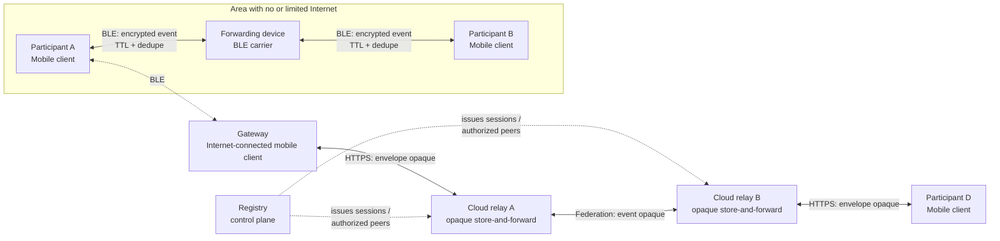
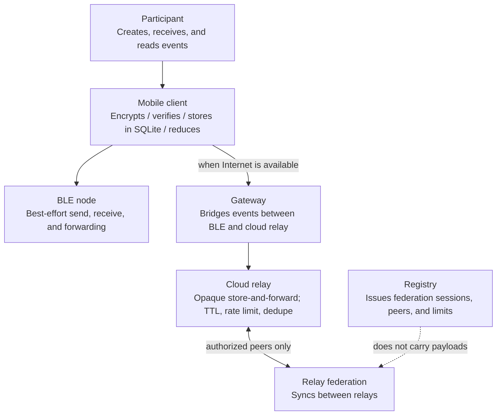
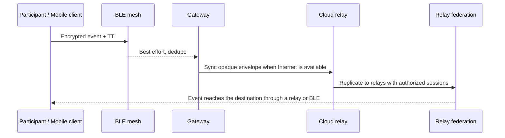

# PeerMesh Network Model

> **Principle:** BLE provides nearby communication; cloud is an optional store-and-forward layer. Each device continues to operate without Internet access.

## 1. Overview

## 2. Roles

| Entity | Primary role |
|---|---|
| Participant | Uses group chat and maps. |
| Mobile client | Autonomous node: creates, encrypts/verifies, and stores events locally; renders state. |
| BLE node / carrier | Discovers and forwards nearby events; delivery and ordering are not guaranteed. Android is better suited to relay; iOS is mainly an edge participant. |
| Gateway | An Internet-connected mobile client that syncs events between the local mesh and a cloud relay. |
| Cloud relay | Stores and forwards **opaque** events; never decrypts or alters payloads. |
| Registry | Federation control plane: issues relay permissions, peers, and limits; never proxies payloads. |
| Relay federation | Syncs between cloud relays authorized by the Registry. |

## 3. Core Data Flow

- Without Internet, BLE still works at nearby range.
- Without BLE, an Internet-connected client can sync through a cloud relay.
- Only clients in the group decrypt plaintext; relays and the Registry cannot read payloads.
