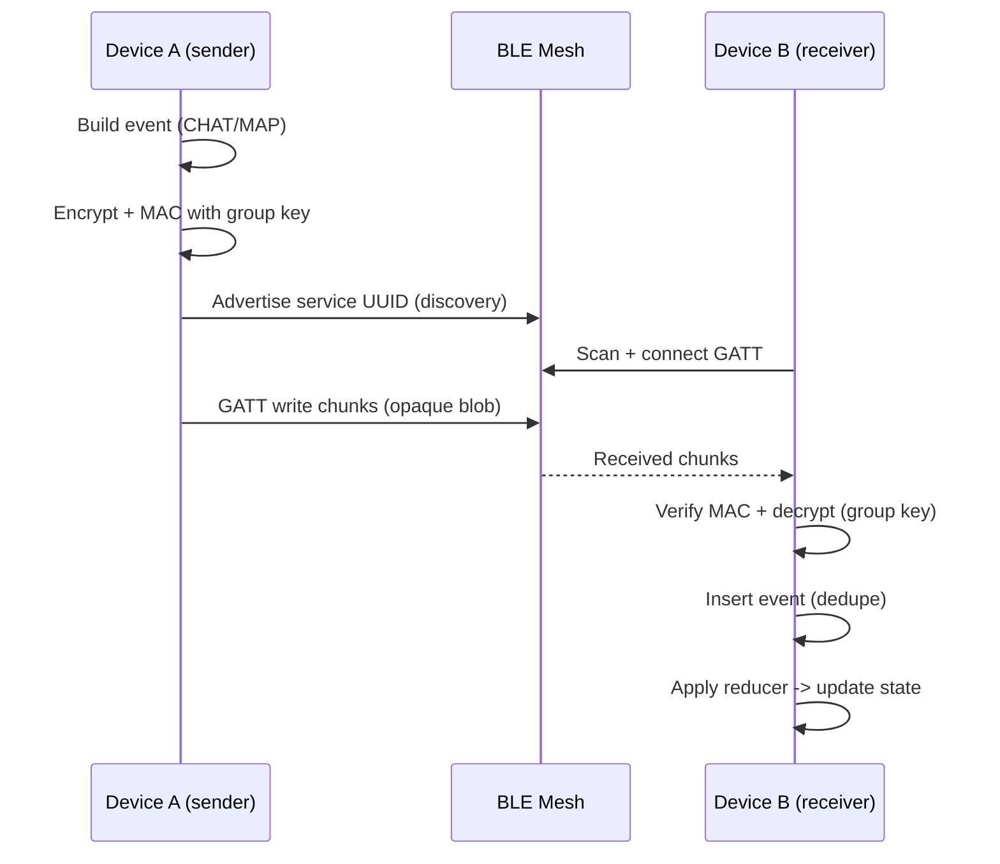
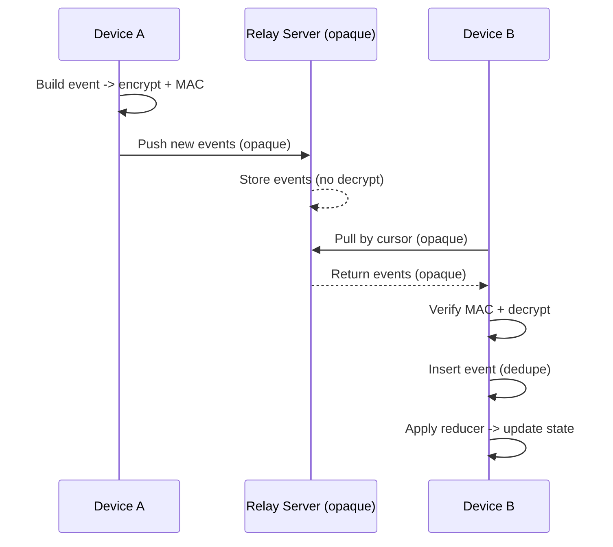

# Phase 2 Technical Specification
## Offline-first Disaster Communication App (Mobile Clients)

Implementation invariants and cross-platform test vectors live in:
- `docs/specs/Cross-platform_Event_Schema_Reducer_Invariants.md`

---

## 1. Purpose & Scope

### 1.1 Purpose
Phase 2 builds **mobile clients** that operate **offline-first**, while also
syncing with the relay server (Phase 1: opaque relay) when internet is available,
serving:
- Internal chat
- Map sharing (marker / area)
- Data propagation via Bluetooth mesh

This phase does **not depend on internet**, but when connectivity exists it will
**sync with the relay** to propagate data beyond BLE mesh range. Phase 2 must
remain compatible with the Phase 1 opaque relay.

---

### 1.2 Non-goals (Explicitly Out of Scope)
- ❌ No blockchain
- ❌ No consensus / validator / mining
- ❌ No analytics / admin dashboard
- ❌ No server DB required to **operate offline**
- ❌ No real-time guarantees (best-effort sync only)
- ❌ No auto-discovery of groups/identity (Phase 3). BLE device discovery still occurs for mesh transport.

---

## 2. High-level Architecture

### 2.1 Architectural Principles
- Offline-first
- Event-based (append-only log)
- Stateless transport
- Deterministic reducer
- Client = autonomous node

---

### 2.2 Layered Architecture

```
+---------------------------+
| UI Layer                  |
| - Chat UI                 |
| - Map UI                  |
+-------------▲-------------+
              |
+-------------|-------------+
| Application Logic Layer   |
| - Event factory           |
| - Reducers (chat/map)     |
| - TTL / cleanup           |
+-------------▲-------------+
              |
+-------------|-------------+
| Security & Group Layer    |
| - Group key derivation    |
| - Encrypt / decrypt       |
| - Signature / MAC         |
+-------------▲-------------+
              |
+-------------|-------------+
| Storage Layer (SQLite)    |
| - Event log               |
| - Materialized views      |
+-------------▲-------------+
              |
+-------------|-------------+
| Transport Layer           |
| - BLE mesh (Android: custom BLE transport) |
+---------------------------+
```

---

## 2.3 Platforms & SDKs

### 2.3.1 Mobile Platforms
- **Android**
  - Language: Kotlin
  - DB: SQLite (Room / SQLDelight)
  - Crypto: Android Keystore + Tink or libsodium
- **iOS** (Phase 2.2+)
  - Language: Swift
  - DB: SQLite (GRDB / SQLite.swift)
  - Crypto: CryptoKit or libsodium

### 2.3.2 Cross-cutting

---

## 3. Transport Layer

### 3.1 Technology Choice
- **Android: custom BLE transport** (BLE primitives; app implements target selection/TTL/dedupe)
- **iOS: Berkanan SDK** (if used)
- BLE mesh via **GATT payload** (ADV for discovery only)
- No pairing
- No session
- Target-based forwarding with TTL, dedupe, and backpressure (best-effort gossip); target selection uses `lastSeen` and RSSI priority.

### 3.2 Transport Rules
- Transport handles **opaque payloads** but may parse envelope metadata for dedupe/TTL/forwarding
- No ordering guarantees
- No delivery guarantees
- Application layer handles dedupe, merge, TTL

Note: Even when envelope metadata is parsed, the payload remains encrypted/opaque to the transport layer.
Note: BLE forwarding should be time-boxed in memory to save power, while relay push remains durable and unbounded; events must still sync to relay when connectivity becomes available.

### 3.3 Sequence Diagrams (BLE + Relay Sync)

#### BLE mesh exchange (offline)



#### Relay sync (online)



Notes:
- Cursor semantics: client tracks `last_cursor` (or last event id/time) per relay and requests incremental data only.
- Retry/backoff: on failed sync, exponential backoff with jitter; on success, reset backoff.

---

## 4. Data Model

### 4.1 Core Model
- All shared data is represented as **events**
- Events are **append-only**
- State is derived via reducers

### 4.2 Event Categories
- `CHAT.*` — messaging
- `MAP.*` — marker / area / layer
- `SYS.*` — presence, alerts, metadata

---

## 5. Event Envelope (Transport-level)

```json
{
  "v": 1,
  "gid": "group_hash",
  "mid": "message_id",
  "ts": 1736500000,
  "ttl": 6,
  "enc": { "ct": "base64url" },
  "sig": { "mac": "base64url" }
}
```

---

## 6. Event Core Schema

```json
{
  "ev": 1,
  "id": "event_id",
  "type": "CHAT.MSG",
  "actor": { "did": "device_id" },
  "time": { "t": 1736500000, "lt": 12 },
  "ref": { "root": "thread_id", "parent": null, "target": null },
  "meta": { "ttl_s": 86400, "prio": "normal", "kid": "base64url" },
  "data": {}
}
```

---

## 7. Reducer Model

### 7.1 Reducer Principles

- Deterministic
- Order-independent
- Last-Write-Wins (LWW)
- Tombstone-based delete
- Tie-breaker: when timestamps are equal, compare `time.lt`, then `actor.did`.

### 7.1.1 Event Identity & Dedupe (Recommended)

- Use a single **event_id** for dedupe across all transports.
- Recommended format: `event_id = base64url(SHA-256(gid | device_id | ts | nonce))`.
- `nonce`: 128-bit random per event.
- Dedupe key: `(gid, event_id)` unique index in SQLite.
- Transport may carry `mid`, but it must equal `event_id` to avoid divergence.

### 7.2 Chat Reducer Rules

- `CHAT.MSG` / `CHAT.REPLY` → create message
- `CHAT.EDIT` → overwrite content if newer (LWW)
- `CHAT.DEL` → tombstone message
- Expired messages auto-marked `expired`
- Message length limit: max **200 characters** (Phase 2).

### 7.3 Map Reducer Rules

- `MAP.MARKER.ADD` → create marker entity
- `MAP.MARKER.UPD` → update fields (LWW)
- `MAP.MARKER.DEL` → tombstone marker
- `TTL` / `expires_at` auto-hide marker
- Same logic for `MAP.AREA.*`

---

## 8. Storage Layer (SQLite – Client-side)

### 8.1 Design Principles

- SQLite is **local to client only**
- WAL mode enabled
- Event log is source of truth
- Materialized tables for fast UI queries

### 8.2 Core Tables

- `groups`
- `events` (append-only, dedupe PK)

### 8.2.1 Storage Indexes (Recommended)

- `events(gid, event_id)` unique
- `events(gid, created_t)` for timeline queries
- `events(gid, type)` for reducers

### 8.3 Chat Tables

- `chat_threads`
- `chat_messages`
- `chat_pending_edits` (optional)

### 8.4 Map Tables

- `map_layers`
- `map_markers`
- `map_marker_field_clock`
- `map_pending_patches`
- `map_areas`

---

## 9. Ingest Pipeline (Client)

```psql
BLE receive
 → decrypt + verify
 → BEGIN TRANSACTION
   → INSERT events (dedupe)
   → APPLY reducer (chat/map)
 → COMMIT
```

Guarantees:

- Idempotent
- Crash-safe
- Duplicate-safe

---

## 10. TTL & Cleanup

### 10.1 TTL Rules

- Message TTL: `created_t + ttl_s`
- Marker TTL: `expires_at` or derived TTL
- Expired entities hidden from UI
- TTL precedence:
  - If `meta.ttl_s` present, use it.
  - Else fallback to type default TTL.
  - Transport `ttl` applies only to BLE forwarding (not storage or relay push).

### 10.2 Cleanup Jobs

- Mark expired entities
- Prune old events
- Prune pending edits / patches


---

## 11. Group Management (Offline)

### 11.1 Group Creation

- User provides passphrase
- Generate random `salt` (16+ bytes)
- `gid = SHA-256(passphrase + salt)`
- `group_key = KDF(passphrase, salt)` (32 bytes)
- `kid = base64url(truncate(SHA-256(group_key || salt), 8 bytes))` (key id)
- On join, re-derive `gid` from passphrase+salt and reject if it doesn't match provided `gid`.

### 11.2 Group Storage

- Store `gid`, `kid`, metadata
- Store passphrase only in secure storage (encrypted)

### 11.2.1 Clock Skew Handling

- Accept skew up to ±10 minutes.
- If skew exceeds, still ingest but mark `time.t` as untrusted and use arrival order
  for tie-breaks in reducers.

---

## 12. Sync with Relay (Online)

- Cursor semantics:
  - Track `last_cursor` per relay (server-provided).
  - On pull, request `since=last_cursor`.
- Retry/backoff:
  - Exponential backoff with jitter (e.g., 2s, 4s, 8s… max 5 min).
  - Reset backoff after any successful sync.
- Conflict resolution:
  - Always store event; reducer decides final state (LWW).
- Sync modes (Android):
  - **Normal**: sync only when network is available.
  - **Battery Saver**: sync only when network is available, runs on 15-minute WorkManager interval.
- Developer Mode (temporary):
  - UI toggle to allow **HTTP relay URLs** for local testing.
  - Must be **removed/disabled** before production release (HTTPS only).
 - Concurrency control:
   - Single-flight relay sync (only one run at a time).
   - Coalesce overlapping requests: if a sync is already running, mark pending and run once more after completion.
- Relay push policy:
  - Relay does **not** reject expired events (offline long‑tail should still sync).
  - Invalid events (e.g., parse failure or missing signature) are marked and excluded from future pushes.
  - Cursor advances past dropped events to avoid being stuck on bad rows.
  - Invalid events are pruned after a retention window (default 7 days).

---

## 13. UI Query Contract (Examples)

### 13.1 Chat Messages

```sql
SELECT * FROM chat_messages
WHERE gid=? AND status='active'
ORDER BY created_t ASC;
```

Chat send UX (Android):
- Disable send when BLE permissions are missing.
- Inline error state when send fails.
- Auto-refresh message list on ingest events (observer/broadcast; no polling).
- Test screen shows BLE permission status with Grant button; when denied repeatedly, show App Settings hint.
- Allow send even when offline/nearby=0 (message created locally).
- Lock input + Send until the newly sent message renders.
- Delivery status in bubble: `sent` → `delivered` (relay push ok or received ACK) → `seen` (seen ACK).
- Relay push on Send only if relay sync enabled; exception: Battery Saver mode.
- Chat UI refresh on relay status changes (debounced 2s) to reflect delivery updates.

### 13.2 Active Map Markers

```sql
SELECT * FROM map_markers
WHERE gid=? AND layer_id=? AND status='active';
```

### 13.3 UX Guardrails

Reference: `docs/private/THREAT_MODEL.md` (Section 8: UX & Communication Guardrails).
UI checklist: `docs/mobile/phase2_android_ui_checklist.md`.

- Avoid words implying certainty or command; prefer “reported”, “observed”, “unverified”.
- No authority signals: no “verified”, no admin/leader roles, no official badges.
- Display freshness and uncertainty (timestamp/TTL, corroboration count).
- Prevent feed domination: group similar events, progressive disclosure under load (recommended for Map UI; optional for Chat UI in Phase 2).
- Avoid urgency framing or mass call-to-action UI.
- Provide a visible “limitations” section in-app (Emergency flavor only; optional for Commercial).

### 13.4 Map UI Performance Notes (OSMDroid)

Current implementation notes worth improving:
- Overlay rebuild is scheduled after scroll/zoom events, which can cause frequent re-renders after user interaction pauses. (Resolved via scroll-idle rendering and viewport change re-render.)
- `renderMapOverlays(...)` clears all overlays and recreates markers/labels/areas each refresh. (Resolved: reuse overlay bundles per marker/area; update in place and add/remove only when needed.)
- Trail overlays are rebuilt after scroll idle and can re-add polylines and endpoint markers. (Partially mitigated via viewport filtering.)
- Radius circles are recomputed per render (48-point polygon per selected marker). (Resolved: cached circle points per marker and area geometry points per area, with LRU limits to bound memory.)
- `mapView.invalidate()` is called after each render, even if overlay set is unchanged. (Resolved: diff-based updates track changes and invalidate only when overlays change.)
- Markers/areas are now rendered only when inside the map viewport (with padding) after scroll/zoom/resize.
- Map list refresh is now interval-based (60s) and paused during draft; submit resets the refresh timer.

Performance tasks are tracked in `docs/milestones/Phase_2_Task_List.md` under "Map UI Performance (OSMDroid)".

---

## 14. Phase 2 Deliverables

### Must-have

- BLE mesh communication (Android: custom BLE transport; iOS: Berkanan SDK if used)
- BLE mesh payloads use GATT (ADV for discovery only; no pairing)
- Event ingest + reducer
- SQLite storage
- Chat (basic)
- Map markers / areas
- TTL & cleanup

### Nice-to-have

- Pending patch handling
- Presence events
- Priority filtering

---

## 15. Phase 2 Compatibility (Forward Design)

Phase 2 must remain compatible with:

- Server relay sync (push / pull)
- Cursor-based incremental sync
- No reducer changes required

### 15.1 Relay Test Deployment (Mini PC / Tailscale Funnel)

For Phase 2 testing, a **production-grade relay** can be hosted on a mini PC and
publicly exposed via **Tailscale Funnel** while keeping local ports bound to
localhost.

Key decisions and constraints:
- Relay/Postgres/metrics ports bound to `127.0.0.1` on host.
- Public access via `https://<host>.<tailnet>.ts.net` (Tailscale Funnel).
- `server/start.sh` loads `server/.env` and passes `--env-file` to compose.
- VPN kill-switch must allow loopback (`lo`) and Docker bridge traffic.
- Partition auto-create enabled to avoid ingest failures on future timestamps:
  - `PARTITION_AUTO_CREATE_ENABLED=1`
  - `PARTITION_AUTO_CREATE_MONTHS_AHEAD` set per TTL/time skew expectations.
- For early testing, `REQUEST_SIGNATURE_ENABLED=0` is acceptable; production should
  enable request signatures and require app-side signing.

---

## 16. Summary

Phase 2 delivers a **fully functional, offline-first, mesh-based communication app** where:

- Each client is an autonomous node
- Data propagates via gossip
- State is deterministic
- Works offline-first; syncs via relay when available

This phase establishes a **clean foundation** for Phase 3 without technical debt.

---

## 16.1 Phase 3.1 (Optional) Items

- Upgrade BLE GATT write API to `writeCharacteristic(characteristic, value, writeType)` with fallback for < API 33.
- Adaptive cache caps (Phase 3.1): auto-tune deduper/reassembly limits based on memory pressure + flood rate.
- Message retention policy (Phase 3.1): default keep forever; optional auto-delete by time since send/seen. See `docs/specs/PHASE_3_1_TECHNICAL_SPEC.md`.

---

## 17. Implementation Notes

### 17.1 Crypto & Integrity

#### 17.1.1 MAC & Canonicalization
- MAC algorithm: **HMAC-SHA256** with `group_key`.
- Canonical JSON to MAC:
  - Canonical JSON of the **envelope without `sig`**.
  - Stable key ordering, UTF-8, no extra whitespace.
- `sig.mac` is base64url of the HMAC digest.

#### 17.1.2 Anti-replay
- Each event has unique `event_id`.
- Maintain a local `seen(event_id)` cache per `gid` with TTL (e.g., 24h).
- On ingest:
  - If `event_id` already seen → drop event (duplicate/replay).
  - Otherwise, store and proceed with reducer.

### 17.2 Transport Constraints (BLE)

- BLE payloads sent over **GATT write**.
- Default chunk payload size: **20 bytes** (MTU 23 safe), with MTU negotiation enabled.
- Chunk size is capped by `maxChunkBytesCap` after MTU negotiation.
- Envelope fragmentation:
  - Split into chunks with `chunk_id`, `chunk_index`, `chunk_total`.
  - Receiver reassembles with timeout (e.g., 10s).
- Flood control:
  - Use randomized backoff to avoid storms (e.g., 200–500ms jitter).
  - Drop duplicate chunks using a TTL cache keyed by chunk payload bytes.
- Scan profile:
  - App **foreground** → `SCAN_MODE_LOW_LATENCY`, `reportDelay=0`.
  - App **background** → `SCAN_MODE_BALANCED`, `reportDelay=2000ms`.
- BLE mesh foreground notification shows live traffic (up/down totals + rates).
- Recommended reliability controls:
  - Cap concurrent GATT connections (default max 4) + idle disconnect rotation when cap is full and others are waiting.
  - Round-robin device scheduling to avoid starvation.
  - Per-device send budget per cycle; drop/defers when overloaded.
  - GATT timeout/cleanup for stalled connections.
  - Background health check: restart BLE mesh service if killed and conditions allow:
    - Active group is set (mesh intended to run).
    - BLE permissions granted.
    - Bluetooth enabled + BLE advertiser available.
    - On API < 31, Location enabled (required for BLE scan).
    - Implementation uses a 15-minute WorkManager safety net and skips if mesh is already running.
  - MTU negotiation + dynamic chunk sizing (reduce overhead).
  - Connection retry/backoff policy for failed GATT connects.
    - Mitigate Samsung `status=133` churn: longer cooldown (10–15s), reduce concurrent GATT when repeated, and skip reconnect for 30s on continuous failures.
  - RSSI-based prioritization under load (prefer closer devices; skip far peers when backpressure is active).
  - Tune deduper/TTL caches to avoid memory bloat during floods.
  - Permissions UX improvements (Nearby/BLE on API 31+, Location on <31).
  - Battery optimization UX: provide quick link to settings (optional).
  - Battery optimization UX (low priority): first-launch prompt with “Do it later”; keep reminder tooltip in future Settings screen.
- Transport-level dedupe by (gid,event_id) before forward to prevent loops.
- Reassembly integrity check (CRC/hash) before ingest/forward.
- Validate/MAC-check envelope before forwarding (avoid relaying corrupt blobs).
  - Do not forward duplicate or expired envelopes (reduce CPU/BLE traffic).
  - Forward mode toggle (Test UI): **Strict verify** (default, verify/decrypt before forward) vs **Forward opaque** (advanced relay; allow cross-group forwarding). Opaque mode still enforces TTL + dedupe + drop duplicate/expired + rate‑limit before forward.
  - JSON-safe TTL update (avoid regex-based replace).
  - Per-device queue cap + drop policy under flood.
  - Adaptive scan/advertise duty cycle under idle/traffic.
    - Tuning note: adjust `IDLE_INTERVALS_THRESHOLD` if scan/advertise oscillation causes instability.
  - Auto‑relay (Option B): enable blind relay on mesh traffic detection, time‑boxed relay window, and throttled forwarding.
    - Default window: 2 minutes after last traffic; trigger cooldown 30s; interval 30s.
    - Fallback: periodic relay sync every 15 minutes when Auto‑relay mode is enabled (WorkManager).
  - Mesh ACK + resend:
    - `SYS.ACK` events with `ack_type=received|seen` and `target_id`.
    - `SYS.MEMBER.REMOVED` events with owner actor and `target_peer_id`.
    - Sender retries 5 times with 5s backoff until `received_group_ack_count>=1` and `received_ack_count>=4`.
    - Track `seen_by` list to render read receipts (2 avatars + “+x others”).

---

## 18. Glossary

- `gid`: Group identifier derived from passphrase + salt; used to scope data and keys.
- `event_id`: Unique identifier for an event; used for dedupe across transports.
- `nonce`: Per-event random value used to ensure uniqueness in `event_id` derivation.
- `cursor`: Server-issued checkpoint used for incremental sync (pull since last cursor).
